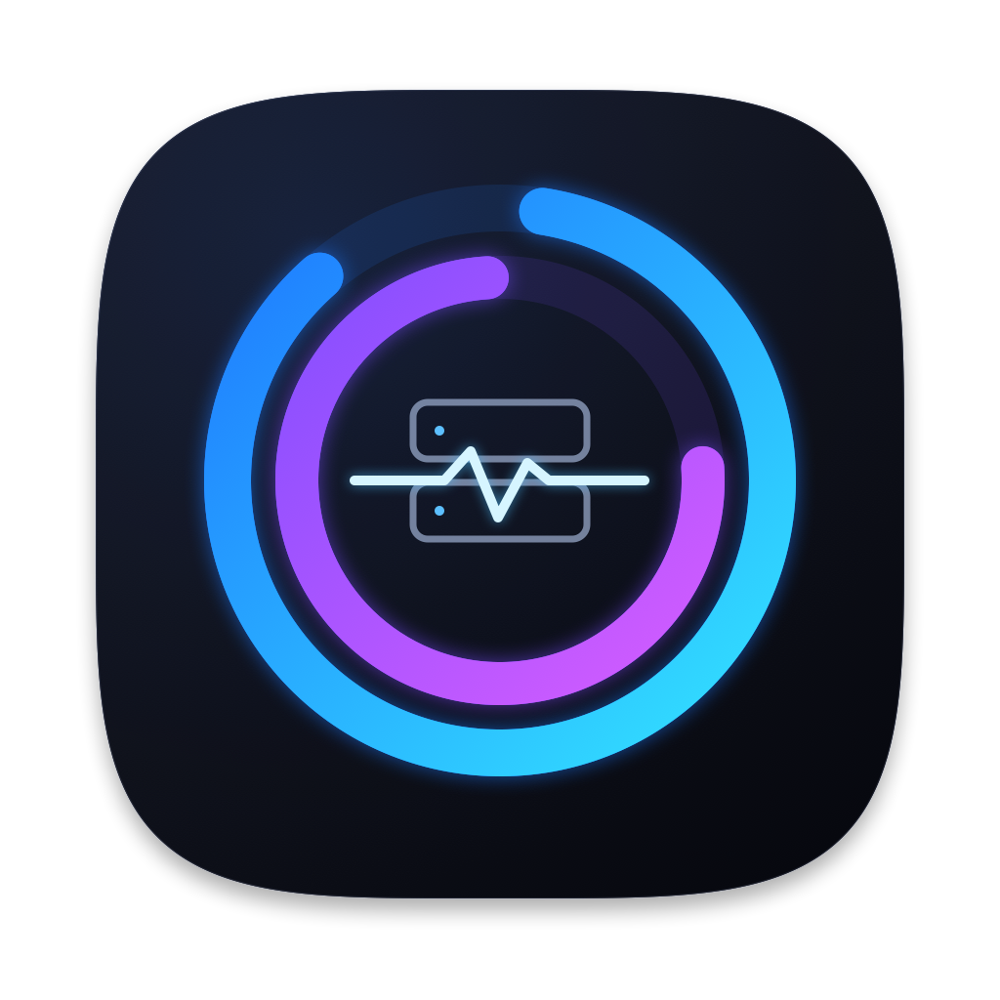
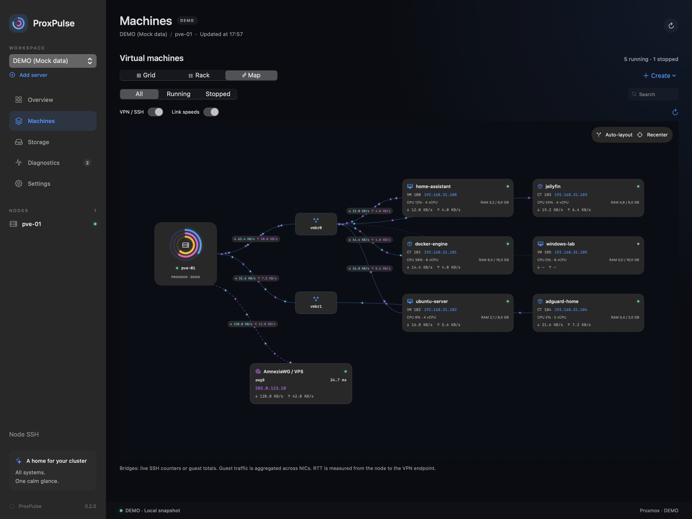
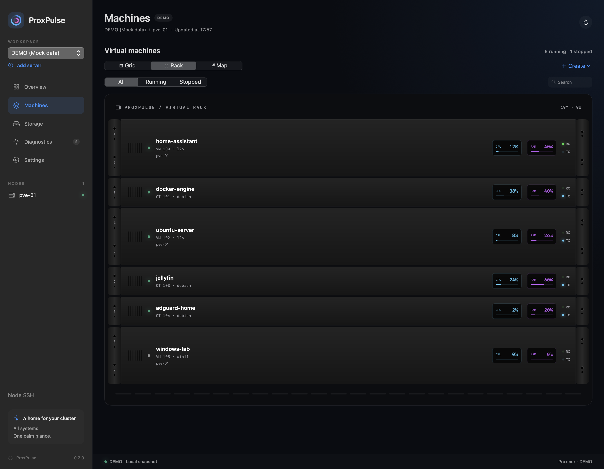
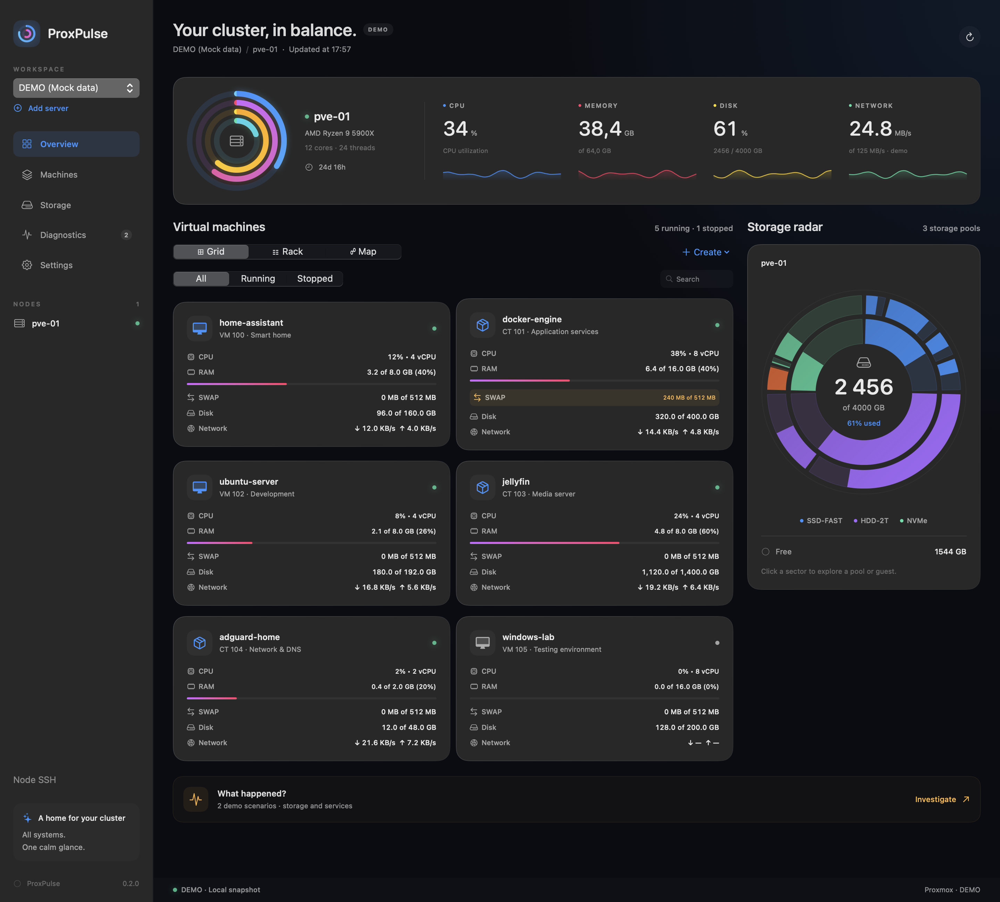
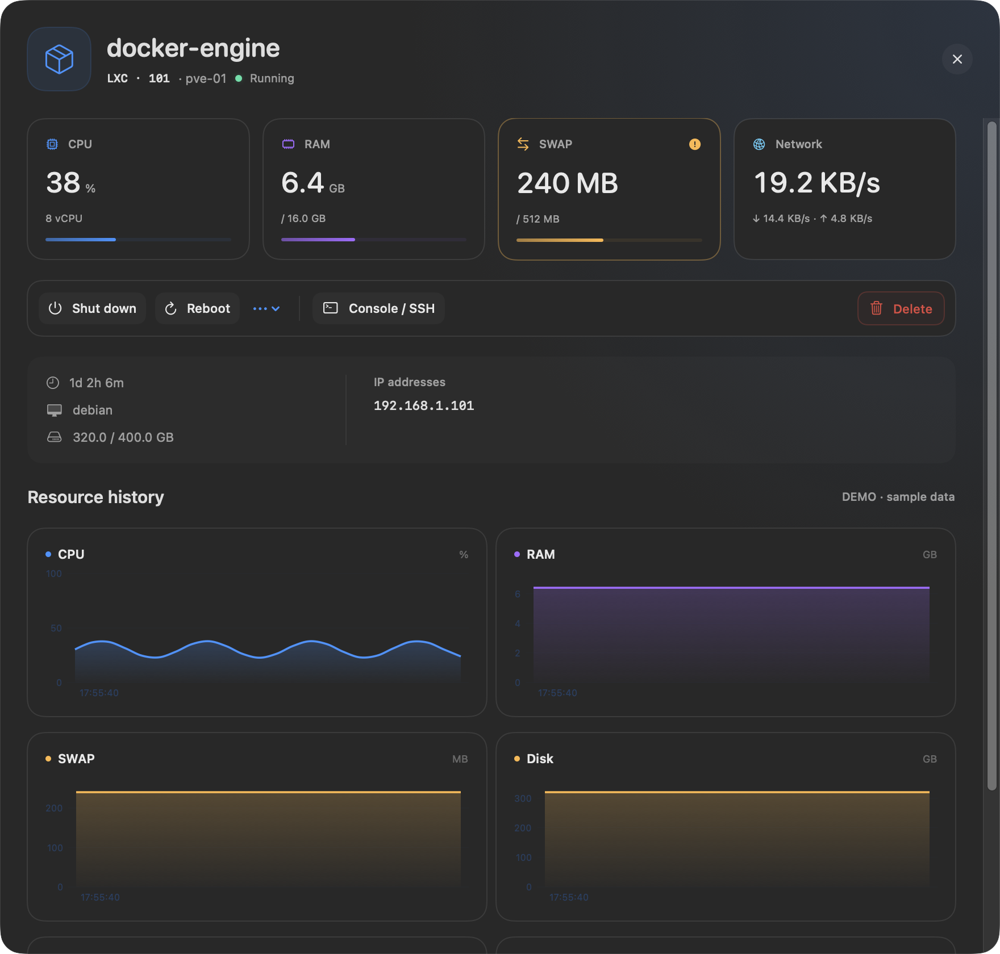

<p align="center">
  
</p>
<h1 align="center">ProxPulse</h1>
<p align="center">Your Proxmox cluster. One calm glance.<br/>Ваш кластер Proxmox. Один спокойный взгляд.</p>
<p align="center">
  <a href="https://github.com/makskondrasov9-dev/ProxPulse/releases/tag/v0.2.0">Release v0.2.0</a> ·
  <a href="https://github.com/makskondrasov9-dev/ProxPulse/releases/download/v0.2.0/ProxPulse-v0.2.0.dmg">Download DMG</a> ·
  macOS 14+ · Apple Silicon & Intel · Swift 6
</p>

[Русский](#русский) · [English](#english) · [Changelog](CHANGELOG.md)

## Gallery / Галерея

Retina screenshots of the actual app with **DEMO data**. Network addresses and workloads shown here are examples.
Снимки настоящего интерфейса с **демо-данными**: адреса и машины служат примерами.

<table>
  <tr>
    <td width="50%"><br/><strong>Topology Map / Карта сети</strong></td>
    <td width="50%"><br/><strong>19-inch Rack / Фронтальная стойка</strong></td>
  </tr>
  <tr>
    <td><br/><strong>Grid & Storage Radar / Сетка и дисковый радар</strong></td>
    <td><br/><strong>Machine Inspector / Инспектор машины</strong></td>
  </tr>
</table>

## Русский

**ProxPulse** — нативный клиент Proxmox VE для macOS на SwiftUI и WidgetKit. Мониторинг кластера, управление VM/LXC, телеметрия и диагностика собраны в одном интерфейсе. Секреты подключения хранятся в Apple Keychain.

### Что нового в v0.2.0

- **Три режима отображения.** Переключайтесь между Сеткой, фронтальной Стойкой 19″ и Картой топологии. В стойке LXC занимает 1U, VM — 2U; статусные лампы, сетевые Tx/Rx-светодиоды и OLED-датчики CPU/RAM показывают состояние машин. Клик по машине в любом режиме открывает общий инспектор.
- **Живая топология сети.** Карта связывает ноду, мосты `vmbr*`, машины и VPN. Помимо API, проверка **VPN / SSH** обнаруживает работающие `awg*`, `wg*`, `tun*`, в том числе AmneziaWG `awg0`, поднятый через awg-quick/systemd. Узел VPS показывает внешний endpoint, RTT и скорости туннеля; световые частицы движутся по направлениям RX/TX с учётом трафика.
- **Интерактивный холст.** Перетаскивайте сервер, мост, VPS или любую машину. Расстановка сохраняется отдельно для профиля и ноды; **Auto-layout / Сбросить расстановку** возвращает авто-дерево, **В центр** подбирает масштаб и центр. Карточки и pan ограничены видимой областью с отступом 24 pt. Максимальный зум сохраняет все карточки внутри экрана.
- **Умные бейджи скорости.** Микро-капсулы вида `↓ 286 B/s  ↑ 91 B/s` используют бирюзовый RX и фиолетовый TX. Если оба направления ниже 10 B/s, бейдж скрывается. Его центр всегда совпадает с точкой `t = 0.5` кривой Безье и следует за перемещением узлов.
- **Мастер создания VM и LXC.** Свободный VMID, шаблоны ОС, ISO, хранилища и мосты загружаются из Proxmox. Для LXC доступны unprivileged/nesting, пароль и SSH-ключи, rootfs, ядра, RAM/SWAP, DHCP/static, gateway, firewall и DNS. Для VM — ISO, QEMU Agent, шина/объём диска/discard, sockets/cores/CPU type, RAM/ballooning и модель сетевой карты. Поддерживаемые поля передаются в одноимённые параметры API; перед созданием можно проверить запрос. Машина создаётся выключенной.
- **Пользовательские пресеты.** Сохраните конфигурацию мастера и заполните форму в один клик. Пресеты хранятся локально; пароль не включается в пресет.
- **Безопасное удаление.** Удаление доступно для остановленной машины. Кнопка уничтожения разблокируется только после точного ввода VMID или имени; запрос использует `purge=1`. Перезагрузка и остановка также требуют подтверждения, а выполнение задачи отображается в карточке.
- **Глубокая телеметрия и новый инспектор.** CPU с лимитом vCPU, занятая/выделенная RAM, SWAP с янтарной подсветкой при использовании, диск, uptime, IP и скорости сети. Стеклянные KPI-плитки, компактная панель действий, SSH/веб-консоль и шесть неоновых графиков: CPU, RAM, SWAP, диск, RX, TX. Наведение показывает направляющую и значение ближайшего замера.
- **Настройки в сайдбаре.** Серверные профили и тест соединения, мгновенное RU/EN, Auto/Dark/Light, пять акцентных цветов (Electric Blue, Cyber Neon, Emerald Green, Royal Purple, Sunset Orange), опрос 2/4/10 секунд, порог диска 80/90/95% и категории уведомлений со звуком.
- **Виджеты Small / Medium / Large.** Кольца ноды, самые загруженные машины и обзор кластера на рабочем столе. Смена LIVE/DEMO или сервера сразу записывает новый снимок в App Group и запрашивает обновление таймлайна; фоновый опрос поддерживает актуальность кеша.

Сохранены кольца активности CPU/RAM/Disk/Net, дисковый sunburst-радар в духе DaisyDisk, меню-бар и детерминированная диагностика «Что случилось?»: OOM, диски, службы и сеть по доступным данным.

### Установка и обновление

1. Скачайте **[ProxPulse-v0.2.0.dmg](https://github.com/makskondrasov9-dev/ProxPulse/releases/download/v0.2.0/ProxPulse-v0.2.0.dmg)**. Рядом опубликована **[контрольная сумма SHA-256](https://github.com/makskondrasov9-dev/ProxPulse/releases/download/v0.2.0/ProxPulse-v0.2.0.dmg.sha256)**.
2. Закройте старую версию. Откройте DMG и перетащите **ProxPulse.app → Applications**, подтвердив замену при обновлении.
3. Запустите `/Applications/ProxPulse.app`. Выберите DEMO или добавьте сервер в WORKSPACE / Настройках. Поддерживаются API Token и логин/пароль; самоподписанный SSL настраивается для каждого профиля.
4. Для виджетов: правый клик на рабочем столе → **Изменить виджеты** → **ProxPulse**. Сначала запустите приложение из Applications; держите его запущенным для свежих метрик.

Требования: **macOS 14 Sonoma+**, Intel или Apple Silicon, HTTPS-доступ к Proxmox VE. Для управления и создания машин нужны соответствующие права Proxmox.

Релиз подписан **ad-hoc**, без Developer ID и нотарификации Apple. При блокировке первого запуска используйте **Системные настройки → Конфиденциальность и безопасность → Всё равно открыть**, если доверяете загруженному релизу. [Инструкция Apple](https://support.apple.com/102445). При замене ad-hoc сборки macOS может повторно запросить доступ к сохранённым данным Keychain.

### Как устроены данные

- Профили и пресеты остаются локально. Пароли/API Secret находятся в **Keychain**, а не в UserDefaults, пресетах или кеше виджетов.
- Для точных счётчиков туннелей и RTT нужны существующий SSH-ключ, доверенный `known_hosts` и Python 3 на ноде. Пробник только читает данные. RTT относится к внешнему VPN endpoint и не подтверждает доступность сервиса внутри туннеля.
- Виджеты читают последний снимок `group.proxpulsedata` при каждом запросе таймлайна. Ручное переключение и первый LIVE-ответ немедленно запрашивают обновление; фоновые запросы ограничены 20 секундами. Фактическое время перерисовки определяет macOS.
- История графиков накапливается за текущую сессию, до 120 замеров. Неизвестные метрики обозначены прочерком. QEMU может не возвращать SWAP/занятое место внутри ОС; для IP VM нужен QEMU Guest Agent.
- Дисковый радар показывает логические хранилища Proxmox: общий backing pool может учитываться несколько раз. Размещение дисков гостей по хранилищам в LIVE автоматически не определяется.
- Уведомления локальные, работают при запущенном приложении. Диагностические рекомендации не выполняются автоматически.

## English

**ProxPulse** is a native Proxmox VE client for macOS, built with SwiftUI and WidgetKit. Monitor your cluster, manage VM/LXC workloads and inspect telemetry in one interface. Connection secrets stay in Apple Keychain.

### What's new in v0.2.0

- **Three workspace modes.** Switch between Grid, a front-facing 19″ Rack and Topology Map. Rack blades use 1U for LXC and 2U for VM, with status lamps, Tx/Rx LEDs and OLED-style CPU/RAM meters. Clicking a machine in any mode opens the shared inspector.
- **Live network topology.** Connect the node, `vmbr*` bridges, machines and VPN. In addition to the API, **VPN / SSH** detects runtime `awg*`, `wg*` and `tun*` interfaces, including AmneziaWG `awg0` started by awg-quick/systemd. The VPS node shows its public endpoint, RTT and tunnel rates. Directional light particles follow RX/TX traffic.
- **Interactive canvas.** Drag the server, bridges, VPS or machines. Positions persist per profile and node; **Auto-layout** restores the tree, while **Recenter** fits and centers it. A hard 24 pt boundary keeps complete cards and camera pan within the viewport. Maximum zoom also keeps all cards visible.
- **Smart speed badges.** Intrinsic-sized capsules such as `↓ 286 B/s  ↑ 91 B/s` use cyan RX and purple TX. A badge disappears when both directions are below 10 B/s. Its center follows the exact `t = 0.5` point of its cubic Bezier curve as nodes move.
- **VM and LXC creation wizard.** Load a free VMID, OS templates, ISO images, storage and bridges from Proxmox. LXC supports unprivileged/nesting, password/SSH keys, rootfs, cores, RAM/SWAP, DHCP/static addressing, gateway, firewall and DNS. VM supports ISO, QEMU Agent, disk bus/size/discard, sockets/cores/CPU type, RAM/ballooning and NIC model. Supported fields map directly to Proxmox API parameters; review the request before creation. New machines remain stopped.
- **User presets.** Save a wizard configuration locally and apply it in one click. Passwords are excluded from presets.
- **Guarded deletion.** A machine must be stopped. Destruction requires typing its exact VMID or name before a `purge=1` request. Reboot and stop actions also require confirmation; cards track pending operations.
- **Advanced telemetry and redesigned inspector.** CPU/vCPU allocation, used/allocated RAM, amber SWAP activity, disk, uptime, IP addresses and network rates. Glass KPI tiles, a compact action toolbar, SSH/web console and six neon history charts: CPU, RAM, SWAP, disk, RX and TX. Hover reveals a guide and the nearest sample value.
- **Sidebar settings.** Profiles and connection tests, instant Russian/English, Auto/Dark/Light, five accents (Electric Blue, Cyber Neon, Emerald Green, Royal Purple, Sunset Orange), 2/4/10-second polling, 80/90/95% disk thresholds and notification categories with sound.
- **Small, Medium and Large desktop widgets.** Node rings, top resource consumers and cluster overview. Switching LIVE/DEMO or server immediately writes a fresh App Group snapshot and requests a timeline reload; polling keeps the cache current.

Also included: CPU/RAM/Disk/Net activity rings, a DaisyDisk-style storage sunburst, menu-bar overview and deterministic incident diagnostics based on available OOM, disk, service and network evidence.

### Install or upgrade

1. Download **[ProxPulse-v0.2.0.dmg](https://github.com/makskondrasov9-dev/ProxPulse/releases/download/v0.2.0/ProxPulse-v0.2.0.dmg)** and its **[SHA-256 checksum](https://github.com/makskondrasov9-dev/ProxPulse/releases/download/v0.2.0/ProxPulse-v0.2.0.dmg.sha256)**.
2. Quit the previous version. Open the DMG and drag **ProxPulse.app → Applications**, replacing the app when upgrading.
3. Launch `/Applications/ProxPulse.app`. Try DEMO or add a server in WORKSPACE / Settings. API tokens and password authentication are supported; self-signed TLS can be enabled per profile.
4. Right-click the desktop → **Edit Widgets** → **ProxPulse**. Launch the app from Applications first and keep it running for fresh metrics.

Requires **macOS 14 Sonoma+**, Intel or Apple Silicon, HTTPS access to Proxmox VE and appropriate Proxmox permissions for management/provisioning actions.

This release is **ad-hoc signed**, without Developer ID or Apple notarization. If macOS blocks the first launch and you trust the download, use **System Settings → Privacy & Security → Open Anyway**. See [Apple's instructions](https://support.apple.com/en-us/102445). Replacing an ad-hoc build may prompt for Keychain access again.

### Data and operational details

- Profiles and presets stay local. Passwords and API secrets stay in **Keychain**, outside UserDefaults, presets and widget snapshots.
- Runtime tunnel counters and RTT require an existing SSH key, trusted `known_hosts` entry and Python 3 on the node. The probe is read-only. RTT measures the outer VPN endpoint, not service availability inside the tunnel.
- Widgets read the latest `group.proxpulsedata` snapshot on every timeline request. Manual source changes and the first LIVE response request an immediate reload; background requests are limited to once every 20 seconds. macOS controls actual widget refresh timing.
- Charts retain up to 120 samples during the current session. Missing metrics display a dash. QEMU guest SWAP/filesystem usage can be unavailable; VM IP addresses require QEMU Guest Agent.
- The radar reports logical storage, which may share physical backing capacity. Live guest-to-storage placement is not inferred automatically.
- Notifications are local and require the app to run. Diagnostic recommendations are not executed automatically.

## Build from source / Сборка

Requires Swift 6 and the macOS SDK: Xcode 16+ or compatible Command Line Tools. There are no third-party runtime dependencies.

```sh
git clone https://github.com/makskondrasov9-dev/ProxPulse.git
cd ProxPulse
./scripts/verify-local.sh       # Build, API/core/UI checks, WidgetKit executable
./scripts/build-release.sh      # Optimized universal app + WidgetKit extension
./scripts/create-dmg.sh         # dist/ProxPulse-v0.2.0.dmg + SHA-256
```

The compatibility helper confines any SDK compatibility adjustments to `.build`; it does not modify the SDK. On restricted development hosts, `PROXPULSE_LOCAL_CACHE=1` keeps SwiftPM caches inside the workspace. `PROXPULSE_REUSE_ICON=1` reuses the checked-in icon during release builds.

Open **ProxPulse.xcodeproj** and select the **ProxPulse** scheme for Xcode development. `project.yml` is the XcodeGen source; regenerate with `xcodegen generate` after project changes. Command Line Tools builds compile runtime targets with SwiftPM and link the WidgetKit entry point separately. XCTest targets require full Xcode; standalone API fixtures and native UI checks are included for CLT-only development.

For Developer ID distribution, configure your Team and registered App Group, then sign and notarize the app.

```text
Sources/ProxPulseCore       API actor, models, Keychain, diagnostics, shared widget state
Sources/ProxPulse           SwiftUI app, dashboard, inspector, settings, notifications
Sources/ProxPulseWidgetUI   Widget views and timeline provider
WidgetExtension            WidgetKit entry point
Resources                  CoreGraphics icon and iconset
scripts                    Build, verification, packaging and installation
```

UI screenshots can be regenerated from the DEBUG app with `--release-media`. The command renders only DEMO fixtures into `docs/images/`; it does not require server credentials. See [CHANGELOG.md](CHANGELOG.md) for release notes.
